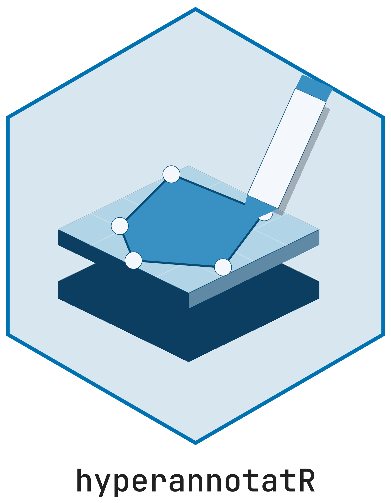

<!-- README.md is generated from README.Rmd. Please edit that file -->

```{r, include = FALSE}
knitr::opts_chunk$set(
  collapse = TRUE,
  comment = "#>",
  fig.path = "man/figures/README-",
  out.width = "100%"
)
# Image plots draw one rectangle per displayed pixel; ragg renders them with
# exact colours, whereas some native devices darken the image slightly.
if (requireNamespace("ragg", quietly = TRUE)) knitr::opts_chunk$set(dev = "ragg_png")
```

# hyperannotatR <picture class="cttir-readme-logo"><source class="cttir-logo-dark-source" media="(prefers-color-scheme: dark)" srcset="man/figures/logo-with-name-dark.png" /></picture>

<!-- badges: start -->
[](https://github.com/CTTIR/hyperannotatR/actions/workflows/R-CMD-check.yaml)
[](https://cttir.github.io/hyperannotatR/)
[](https://app.codecov.io/gh/CTTIR/hyperannotatR)
[](https://opensource.org/licenses/MIT)
[](https://lifecycle.r-lib.org/articles/stages.html#experimental)
<!-- badges: end -->

**hyperannotatR** provides multi-layer region-of-interest annotation for
hyperspectral imaging (HSI), including spectral cubes, band views, spectral
extraction, and associated display rasters. ROI geometries, masks, resumable
sessions and exports support HSI annotation and classification.

Cell and nucleus annotation, segmentation, correction, training and review for
microscopy belong to **segmantR**. Its independent drawing canvas and mask
workflow do not require hyperannotatR. Generic raster and geometry APIs remain
available for HSI previews and interchange compatibility.

The R package was renamed from `annotatR` to `hyperannotatR`; load it with
`library(hyperannotatR)`. The `at_*` function names and saved object classes are
retained. The hosted source repository is `CTTIR/hyperannotatR`.

## Installation

```r
# install.packages("pak")
pak::pak("CTTIR/hyperannotatR")
```

## Quick start

```{r quickstart, message = FALSE}
library(hyperannotatR)

# Read a bundled example image and build a project with one annotation layer.
img <- at_example_image("tissue")
proj <- at_project(img, at_layer("regions", labels = c("tumour", "stroma")))

# Add regions of interest.
proj <- proj |>
  at_add_roi("regions", at_roi_rect(120, 150, 260, 290, label = "tumour")) |>
  at_add_roi("regions", at_roi_circle(400, 120, 60, label = "stroma"))

at_rois(proj)[, c("roi_id", "label", "area_px")]

# Rasterise to a labelled mask (the "Schablone") and write it with a legend.
mask <- at_mask(proj, type = "labelled")
path <- tempfile(fileext = ".tif")
at_write_mask(mask, path)             # also writes <path>.legend.json
```

```{r overlay, message = FALSE, fig.height = 4}
at_plot_overlay(proj)
```

## Supported formats

| Format | Backend | Package required | Pyramid | Spectral |
|---|---|---|---|---|
| PNG / JPEG | `raster` | magick | no | no |
| TIFF, incl. pyramidal and multi-channel | `tiff` | tiff | yes | multiplex |
| qptiff, OME-TIFF | `ometiff` | RBioFormats + xml2, windowed reads | yes | multiplex |
| Cubert `.cu3s` | `cuvis` | cuvis.r + CUVIS SDK | no | yes |
| ENVI cube (BSQ/BIL/BIP) | `envi` | base R, windowed reads | no | yes |
| Diaspective Vision TIVITA | `tivita` | base R, declared profile or sidecar | no | yes |

A TIFF is treated as spectral only when wavelengths are declared. `at_bands()`,
`at_hsi_meta()` and `at_read_stats()` report band wavelengths and gaps, value
units, calibration and transform digests, and the bytes actually read.
The ENVI, TIVITA and OME readers read windows from the file; the raster, TIFF
and Cubert backends decode the whole image when it is opened, so it must fit in
memory. `at_image_capabilities()` reports which applies to an image.

The `raster` backend converts samples to a 0–255 display convention and does
not preserve original high-bit-depth intensities. The quantitative TIFF, OME
and ENVI readers keep raw samples; format and optional-reader limits are
documented in `vignette("images-and-backends")`. Extraction never applies plot
contrast stretches. It reports selected, finite and nonfinite counts, with an
explicit `nonfinite` policy and declared spectral units.

## The mask workflow

A **mask** is the central output artifact: a binary, labelled, or multi-class
integer raster derived from your annotations, exportable at any pyramid level
and self-describing via a sidecar JSON legend. Masks feed segmentation,
classification, and spectral-extraction pipelines in Python, ImageJ, QuPath,
or R. See `vignette("masks")` for the pixel-coverage contract and downstream
consumption.

## The annotation app

```r
# Launch the batch annotation app over a queue of images:
at_annotate(at_example_session(5))
```

Iterate through an image queue, draw multi-layer ROIs, watch the mask render
live, and export everything in one pass — with resumable sessions and
keyboard-first throughput. `at_app()` returns the same app as a `shiny.appobj`
for embedding and testing.

## Working with qupflowR

hyperannotatR exchanges annotations with the qupflowR package through a versioned,
hash-inventoried contract. `at_interop_capabilities()` reports which profiles
this installation supports; the file (I0) and R API (I1) profiles are
supported, while direct app control (I2) and embedding (I3) stay *planned*
until they are qualified against a real qupflowR client.

```r
dest <- file.path(tempdir(), "handoff")
receipt <- at_export_qupflowr(proj, dest)            # QuPath GeoJSON, masks, manifest, integrity
report <- at_import_qupflowr(dest)                    # verified, namespaced, never runs analysis
patch <- at_stage_qupflowr(proj, report)              # diff; reviewed ROIs become conflicts
committed <- at_commit_qupflowr(patch, idempotency_key = "review-42")
```

`at_training_export()` writes leakage-free, grouped deep-learning datasets with
integer masks and full provenance, and `at_training_import()` stages model
predictions for review. An optional loopback control service
(`at_control_start()`, protocol `annotatr-control-v1`) lets a partner process
read state and events and send typed commands to a running app. See
`vignette("partner-interop")`.

## Related work

Unlike QuPath, the ImageJ ROI Manager, napari, or Annotorious, hyperannotatR is
R-native and script-first, focuses on hyperspectral cubes and their display rasters,
and treats the batch **mask** export as a first-class, reproducible artifact.

## Acknowledgements

hyperannotatR builds on [Shiny](https://shiny.posit.co/), the
[`sf`](https://r-spatial.github.io/sf/) and
[`stars`](https://r-spatial.github.io/stars/) packages.

## Use of LLM tools

Where applicable, LLM tools were used for narrowly defined, non-authorial tasks:
copyediting, prose refinement, Markdown/LaTeX formatting, boilerplate scaffolding
(such as CI configurations and build scripts), and code refactoring. Tools included
[Chat AI](https://kisski.gwdg.de/leistungen/2-02-llm-service/), the KISSKI
(GWDG) service, and self-hosted **Mistral Small (24B, Apache-2.0)** served through
a local **vLLM architecture** on an Ubuntu Linux workstation with Intel
processors and NVIDIA GPUs. The self-hosted model ran locally, with no data sent
to third parties.

All scientific claims, methodological choices, analyses, interpretations and
conclusions remain the authors' own. Where applicable, LLM-generated material
must be reviewed and revised before inclusion, and references must be verified
against their DOI, arXiv ID or ISBN.

Local software setup: vLLM with Python/PyTorch, plus R and RStudio.

## Branding

Editable R sources and regeneration instructions are in
[tools/branding](https://github.com/CTTIR/hyperannotatR/tree/main/tools/branding).
