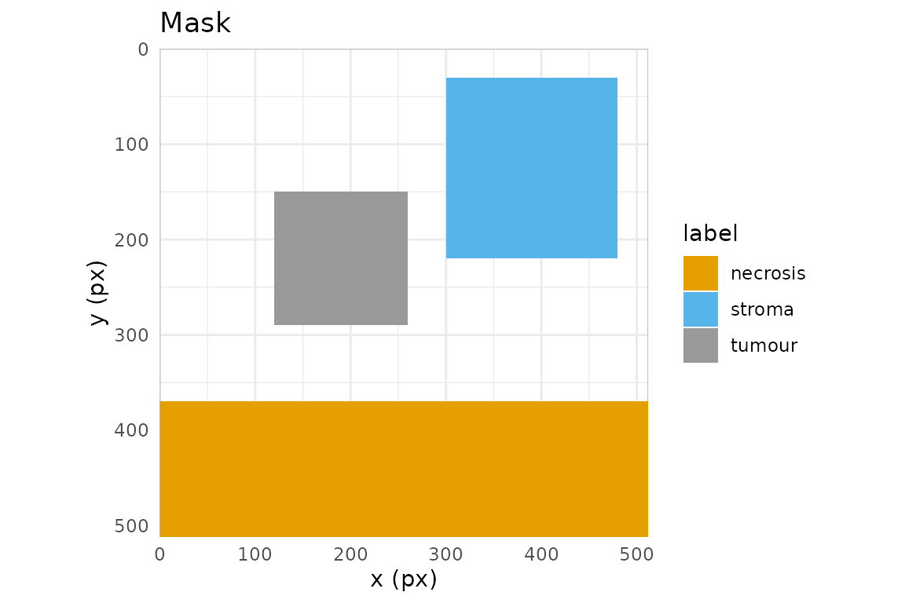

# Masks


A *mask* is the artefact that turns hand-drawn regions into something a
segmentation or classification pipeline can consume: an integer raster
on the same pixel grid as the image, where each pixel carries the
identity of the region it belongs to. In hyperannotatR the mask is the
core deliverable, and
[`at_mask()`](https://cttir.github.io/hyperannotatR/reference/at_mask.md)
is the function that produces it from an `annot_roi`, an `annot_layer`,
or a whole `annot_project`.

## Three mask types

[`at_mask()`](https://cttir.github.io/hyperannotatR/reference/at_mask.md)
writes one of three rasters, chosen with `type`:

- **`"binary"`** — a logical matrix: `TRUE` wherever *any* region covers
  a pixel, `FALSE` elsewhere. Use it for foreground/background problems
  (“is this pixel annotated at all?”).
- **`"labelled"`** — one distinct positive integer per ROI, assigned in
  draw order. Use it when individual objects must stay separable,
  e.g. instance segmentation where two adjacent tumour nests are
  different things.
- **`"multiclass"`** — one integer per *label class*, so every ROI
  sharing a label collapses to the same value. Use it for semantic
  segmentation, where you care about the class (“tumour”, “stroma”) and
  not the particular ROI.

Every mask is an `annot_mask`: a matrix with an attached `legend` tibble
(`value`, `label`, `layer`, `roi_id`, `n_px`, `colour`) plus `level`,
`dims`, `mask_type` and `mask_metadata` attributes; the last records how
to read the values (below). Read the legend back with
[`at_mask_legend()`](https://cttir.github.io/hyperannotatR/reference/at_mask_legend.md).

## Encoding metadata and alignment

`attr(mask, "mask_metadata")` is a versioned semantic description.
Schema 1 records `encoding`, `background`, `overlap`, a `grid` (`dims`
in width/height order, `level`, `origin`, and sampling `stride`), the
full `codebook`, and `source` provenance. Rasterisation uses origin
`(0,0)` and stride `(1,1)`. A nearest-neighbour preview records its
sampled dimensions and stride plus `preview$parent_grid`; its counts
describe only sampled pixels.

Public type names remain unchanged. Ordinary multiclass masks use
categorical encoding: category `3` belongs only to class `3`. With
`overlap = "bitor"`, codes must be distinct positive powers of two and
background must be zero. A sample `3` then belongs to both class `1` and
class `2`. Legends, statistics, previews, polygonisation, and display
use this same membership rule. Composite display labels join their class
names with `+` and use the mean class colour. A supplied global `values`
map survives even if some classes have no pixels; those classes retain
zero counts. Empty legends recover with typed columns.

Foreground codes cannot equal background. Binary rasterisation rejects a
requested background of `1`, including for empty masks. Other accepted
binary backgrounds become effective `FALSE`/`0`, matching the logical
stored samples. NPY imports remain integer arrays, including arrays
declared binary.

Derivation uses each input’s own background and anatomy membership,
preserving the full state codebook. Declared grids and durable source
descriptors must agree. Queue entry IDs are retained as provenance but
need not match for two annotations of the same source; reopened-image
cache generations never establish source equality. Display names alone
are insufficient. Reader options are compared exactly, including atomic
types, names, dimensions, nesting, attributes and formal S4 identity.
Sidecars store options with `options_encoding = "typed-json-v2"`: a
versioned, data-only representation that also records each value’s
formal-object flag. Supported atomic/list S4 values recover without
class constructors or an installed class definition. Numeric options
retain 17-digit precision. Malformed or future option encodings fail.
Older untyped JSON and typed schema 1 cannot prove that all option
structure survived (schema 1 omitted formal-object flags): these sources
are marked `options_status = "legacy-json"` and derivation requires an
explicit alignment assertion, including after re-export. Likewise,
`options_inferred = TRUE` records guessed legacy reader options and
cannot establish verified alignment. Any supplied inference flag must be
a single, non-missing logical value; omitting it leaves explicitly
recorded options unchanged. For standalone masks whose registration you
know, pass `alignment = "assert"` to
[`at_mask_derive()`](https://cttir.github.io/hyperannotatR/reference/at_mask_derive.md).
This records an explicit registration assertion without resampling.
Different matrix dimensions always fail. The default
`alignment = "legacy"` only permits unknown-source fallback when both
masks have legacy metadata and records `legacy-assumed`.
Self-combination records `self-grid`, without claiming an external
source registration.

## The pixel-coverage contract

Rasterisation is only reproducible if the pixel/geometry relationship is
exact, so hyperannotatR pins it down. Pixel `(i, j)` covers the
half-open square `[j-1, j) x [i-1, i)`, with `(0, 0)` at the top-left
corner of the top-left pixel; its centre is therefore
`(j - 0.5, i - 0.5)`. With the default `touches = FALSE`, a pixel is in
the mask when *its centre* lies inside the polygon. Boundary ties use
the symbolic sample `(x + epsilon, y + epsilon^2)` as `epsilon` tends to
zero from above; there is no finite coordinate shift. At each centre y,
edges are active on `[minY, maxY)` and sorted crossing pairs fill
`[left, right)`. For rectangles, lower edges count as inside and upper
edges as outside. For the triangle `(0,0), (5,0), (5,5)`, the diagonal
`y = x` counts as inside: its five rows contain 5, 4, 3, 2, and 1
pixels, respectively. Hole rings remove pixels by parity regardless of
ring orientation, and MultiPolygon components combine by union. Thin
polygons without selected centres produce an empty mask. Single and
batched masks and both engine choices share this centre-membership rule.

Points use their half-open containing cell: point `(5,5)` selects matrix
row 6, column 6, because its cell is `[5,6) x [5,6)`. Multipoints select
the union of these cells. Extraction uses the same support and reads the
corresponding bounded image tile. These boundary rules correct the
earlier finite-shift behavior, which selected row 5, column 5 for an
integer-coordinate point and could produce inconsistent diagonal polygon
coverage.

All-touched masks and line rasterisation retain the selected engine’s
behavior; engine equality is guaranteed for centre-based polygons and
points.

The cleanest way to trust this is to compute a small case by eye. Take a
rectangle from `(2, 2)` to `(5, 5)` on a 10x10 grid:

``` r

r <- at_roi_rect(2, 2, 5, 5, label = "a")
m <- at_mask(r, "binary", dims = c(10, 10))
print(matrix(as.integer(m), 10, 10))
#>       [,1] [,2] [,3] [,4] [,5] [,6] [,7] [,8] [,9] [,10]
#>  [1,]    0    0    0    0    0    0    0    0    0     0
#>  [2,]    0    0    0    0    0    0    0    0    0     0
#>  [3,]    0    0    1    1    1    0    0    0    0     0
#>  [4,]    0    0    1    1    1    0    0    0    0     0
#>  [5,]    0    0    1    1    1    0    0    0    0     0
#>  [6,]    0    0    0    0    0    0    0    0    0     0
#>  [7,]    0    0    0    0    0    0    0    0    0     0
#>  [8,]    0    0    0    0    0    0    0    0    0     0
#>  [9,]    0    0    0    0    0    0    0    0    0     0
#> [10,]    0    0    0    0    0    0    0    0    0     0
```

Rows and columns 3, 4 and 5 are set, and nothing else. The rectangle
spans `x` in `[2, 5)`; the pixel-centre x-coordinates that fall in that
interval are `2.5, 3.5, 4.5`, i.e. columns 3, 4, 5. The centre at
`x = 5.5` (column 6) is outside, and the lower edge at `x = 2` is inside
because centre `2.5 > 2`. The same reasoning on `y` gives rows 3:5. A
rectangle three pixels wide and three pixels high covers exactly nine
pixels, with no fencepost surprises.

## `touches`: centres versus contact

`touches = TRUE` switches to a “does the polygon touch the pixel at all”
rule (GDAL `ALL_TOUCHED=TRUE`), which grows the region by the fringe
pixels a polygon merely clips. It matters when edges cut through pixel
interiors rather than running along the grid. A rectangle with
fractional bounds shows the contrast:

``` r

r2  <- at_roi_rect(2.5, 2.5, 4.5, 4.5, label = "a")
off <- matrix(as.integer(at_mask(r2, "binary", dims = c(8, 8), touches = FALSE)), 8, 8)
on  <- matrix(as.integer(at_mask(r2, "binary", dims = c(8, 8), touches = TRUE)),  8, 8)
#> Registered S3 method overwritten by 'stars':
#>   method                  from
#>   st_interpolate_aw.stars sf
off
#>      [,1] [,2] [,3] [,4] [,5] [,6] [,7] [,8]
#> [1,]    0    0    0    0    0    0    0    0
#> [2,]    0    0    0    0    0    0    0    0
#> [3,]    0    0    1    1    0    0    0    0
#> [4,]    0    0    1    1    0    0    0    0
#> [5,]    0    0    0    0    0    0    0    0
#> [6,]    0    0    0    0    0    0    0    0
#> [7,]    0    0    0    0    0    0    0    0
#> [8,]    0    0    0    0    0    0    0    0
on
#>      [,1] [,2] [,3] [,4] [,5] [,6] [,7] [,8]
#> [1,]    0    0    0    0    0    0    0    0
#> [2,]    0    0    0    0    0    0    0    0
#> [3,]    0    0    1    1    1    0    0    0
#> [4,]    0    0    1    1    1    0    0    0
#> [5,]    0    0    1    1    1    0    0    0
#> [6,]    0    0    0    0    0    0    0    0
#> [7,]    0    0    0    0    0    0    0    0
#> [8,]    0    0    0    0    0    0    0    0
```

With `touches = FALSE` only the pixels whose centres sit inside the
rectangle are kept; with `touches = TRUE` the partially clipped border
pixels join too. Prefer the default for area-faithful masks, and
`touches = TRUE` only when you must not drop thin structures.

## Overlap resolution

When two regions cover the same pixel, `overlap` decides who wins. The
ROIs are rasterised in draw order (ascending `z`, then insertion):

``` r

lyr <- at_layer("regions")
lyr <- at_layer_add(lyr, at_roi_rect(1, 1, 5, 5, label = "a"))
lyr <- at_layer_add(lyr, at_roi_rect(3, 3, 7, 7, label = "b"))
matrix(as.integer(at_mask(lyr, "labelled", dims = c(8, 8), overlap = "last")),  8, 8)
#>      [,1] [,2] [,3] [,4] [,5] [,6] [,7] [,8]
#> [1,]    0    0    0    0    0    0    0    0
#> [2,]    0    1    1    1    1    0    0    0
#> [3,]    0    1    1    1    1    0    0    0
#> [4,]    0    1    1    2    2    2    2    0
#> [5,]    0    1    1    2    2    2    2    0
#> [6,]    0    0    0    2    2    2    2    0
#> [7,]    0    0    0    2    2    2    2    0
#> [8,]    0    0    0    0    0    0    0    0
matrix(as.integer(at_mask(lyr, "labelled", dims = c(8, 8), overlap = "first")), 8, 8)
#>      [,1] [,2] [,3] [,4] [,5] [,6] [,7] [,8]
#> [1,]    0    0    0    0    0    0    0    0
#> [2,]    0    1    1    1    1    0    0    0
#> [3,]    0    1    1    1    1    0    0    0
#> [4,]    0    1    1    1    1    2    2    0
#> [5,]    0    1    1    1    1    2    2    0
#> [6,]    0    0    0    2    2    2    2    0
#> [7,]    0    0    0    2    2    2    2    0
#> [8,]    0    0    0    0    0    0    0    0
```

`"last"` (the default) lets the later-drawn region overwrite; `"first"`
keeps the earlier one; `"max"` and `"min"` resolve by pixel value; and
`"error"` aborts the moment any two regions collide, which is the safest
choice when overlaps should never happen.

`"bitor"` keeps every membership instead of choosing a winner. It is
meant for multiclass masks whose class codes are distinct powers of two:
an overlapping pixel holds the bitwise OR of the codes, so a pixel
covered by `a` (1) and `b` (2) holds 3 and both classes stay recoverable
with [`bitwAnd()`](https://rdrr.io/r/base/bitwise.html).

``` r

bits <- at_mask(lyr, "multiclass", dims = c(8, 8), values = c(a = 1L, b = 2L),
                overlap = "bitor")
matrix(as.integer(bits), 8, 8)
#>      [,1] [,2] [,3] [,4] [,5] [,6] [,7] [,8]
#> [1,]    0    0    0    0    0    0    0    0
#> [2,]    0    1    1    1    1    0    0    0
#> [3,]    0    1    1    1    1    0    0    0
#> [4,]    0    1    1    3    3    2    2    0
#> [5,]    0    1    1    3    3    2    2    0
#> [6,]    0    0    0    2    2    2    2    0
#> [7,]    0    0    0    2    2    2    2    0
#> [8,]    0    0    0    0    0    0    0    0
at_mask_legend(bits)[, c("value", "label", "n_px")]
#> # A tibble: 2 × 3
#>   value label  n_px
#>   <int> <chr> <int>
#> 1     1 a        16
#> 2     2 b        16
```

## Masks from a project

On a real project the mask spans the image grid. The bundled example
carries one layer of three labelled regions:

``` r

proj <- at_example_project()
mc <- at_mask(proj, type = "multiclass")
mc
#> <annot_mask> multiclass  |  512 x 512 px  |  level 0
#> values: 3
#> # A tibble: 3 × 6
#>   value label    layer   roi_id  n_px colour 
#>   <int> <chr>    <chr>   <chr>  <int> <chr>  
#> 1     1 tumour   regions NA     19600 #999999
#> 2     2 necrosis regions NA     72704 #E69F00
#> 3     3 stroma   regions NA     34200 #56B4E9
at_mask_legend(mc)
#> # A tibble: 3 × 6
#>   value label    layer   roi_id  n_px colour 
#>   <int> <chr>    <chr>   <chr>  <int> <chr>  
#> 1     1 tumour   regions NA     19600 #999999
#> 2     2 necrosis regions NA     72704 #E69F00
#> 3     3 stroma   regions NA     34200 #56B4E9
table(as.integer(mc))
#> 
#>      0      1      2      3 
#> 135640  19600  72704  34200
```

[`at_mask_stats()`](https://cttir.github.io/hyperannotatR/reference/at_mask_stats.md)
summarises each value — pixel counts, area, fraction of the frame,
bounding box and centroid — ready for a report table:

``` r

at_mask_stats(mc)
#> # A tibble: 3 × 12
#>   value label     n_px area_px area_physical frac_total bbox_xmin bbox_ymin
#>   <int> <chr>    <int>   <dbl>         <dbl>      <dbl>     <dbl>     <dbl>
#> 1     1 tumour   19600   19600            NA     0.0748       120       150
#> 2     2 necrosis 72704   72704            NA     0.277          0       370
#> 3     3 stroma   34200   34200            NA     0.130        300        30
#> # ℹ 4 more variables: bbox_xmax <dbl>, bbox_ymax <dbl>, centroid_x <dbl>,
#> #   centroid_y <dbl>
```

## Writing masks and the legend sidecar

[`at_write_mask()`](https://cttir.github.io/hyperannotatR/reference/at_write_mask.md)
writes an integer TIFF (16-bit by default), and — because a bare integer
raster is meaningless without a key — a companion `<path>.legend.json`
describing it:

``` r

dir  <- tempfile("masks-"); dir.create(dir)
path <- file.path(dir, "regions.tif")
at_write_mask(mc, path, overwrite = TRUE)
list.files(dir)
#> [1] "regions.tif"             "regions.tif.legend.json"
cat(readLines(paste0(path, ".legend.json")), sep = "\n")
#> {
#>   "mask_metadata": {
#>     "schema_version": 1,
#>     "status": "declared",
#>     "encoding": "categorical",
#>     "background": 0,
#>     "overlap": "last",
#>     "grid": {
#>       "dims": [512, 512],
#>       "level": 0,
#>       "origin": [0, 0],
#>       "stride": [1, 1]
#>     },
#>     "source": {
#>       "entry_id": null,
#>       "descriptor": {
#>         "schema_version": 1,
#>         "signature": {
#>           "size": 526756,
#>           "mtime": 1792423014
#>         },
#>         "files": null,
#>         "path": "/home/runner/work/_temp/Library/hyperannotatR/extdata/example_tissue.png",
#>         "backend": "raster",
#>         "options": {
#>           "schema_version": 2,
#>           "node": {
#>             "type": "list",
#>             "data": [],
#>             "s4": false,
#>             "attributes": null
#>           }
#>         },
#>         "options_identity": "580a0000000200040601000203000000001300000000",
#>         "reader_contract": null,
#>         "options_encoding": "typed-json-v2"
#>       }
#>     },
#>     "codebook": [
#>       {
#>         "value": 1,
#>         "label": "tumour"
#>       },
#>       {
#>         "value": 2,
#>         "label": "necrosis"
#>       },
#>       {
#>         "value": 3,
#>         "label": "stroma"
#>       }
#>     ]
#>   },
#>   "storage": null,
#>   "annotatR_version": "0.3.0",
#>   "created": "2026-10-19T15:18:18+0000",
#>   "mask_type": "multiclass",
#>   "level": 0,
#>   "dims": [512, 512],
#>   "source_project": "example",
#>   "legend": [
#>     {
#>       "value": 1,
#>       "label": "tumour",
#>       "layer": "regions",
#>       "roi_id": null,
#>       "n_px": 19600,
#>       "colour": "#999999"
#>     },
#>     {
#>       "value": 2,
#>       "label": "necrosis",
#>       "layer": "regions",
#>       "roi_id": null,
#>       "n_px": 72704,
#>       "colour": "#E69F00"
#>     },
#>     {
#>       "value": 3,
#>       "label": "stroma",
#>       "layer": "regions",
#>       "roi_id": null,
#>       "n_px": 34200,
#>       "colour": "#56B4E9"
#>     }
#>   ]
#> }
```

The sidecar is self-describing. Its fields, printed above, include the
`annotatR_version`, the `created` timestamp, the `mask_type`, the
pyramid `level`, the raster `dims`, the `source_project`, and the full
`legend` array (one object per value, mirroring the legend tibble). The
sidecar also contains `mask_metadata` schema 1. NPY sidecars separately
record `storage$axes` (`yx` or `xy`) and `storage$shape`; these describe
the array on disk, while the metadata grid describes logical image
samples. For a transposed NPY export, read with
`at_read_npy(..., transpose = TRUE)`. A mismatched explicit orientation
fails even when a square shape would conceal the error.
[`at_read_mask()`](https://cttir.github.io/hyperannotatR/reference/at_read_mask.md)
recovers the declared NPY orientation automatically. Any consumer can
map pixel values back to labels without touching R.

TIFF export accepts `bits = 8L` or `bits = 16L` (the default) and
preserves unsigned integer class codes in `[0, 255]` or `[0, 65535]`.
PNG export remains 8-bit only: values above 255 and all negative values
reject before writing. `bits` controls TIFF only. Both formats reject
fractional/nonfinite samples and out-of-range values before creating or
overwriting the destination. TIFF writing needs `tiff` or a `magick`
build with exact grayscale support; PNG needs the latter. An unavailable
lossless writer produces a capability error. Single-choice arguments
require a scalar: omitted defaults choose the first documented value,
while explicitly supplied vectors are invalid.

## Downstream consumption

A Python pipeline reads the TIFF and its legend directly — no R runtime,
no bespoke format:

``` python
import json
import tifffile

mask = tifffile.imread("regions.tif")            # integer array, image grid
with open("regions.tif.legend.json") as f:
    legend = json.load(f)

value_to_label = {row["value"]: row["label"] for row in legend["legend"]}
tumour = mask == next(v for v, l in value_to_label.items() if l == "tumour")
```

## Reading masks back

Masks are not a dead end.
[`at_read_mask()`](https://cttir.github.io/hyperannotatR/reference/at_read_mask.md)
polygonises an existing mask — hyperannotatR’s own output, or a
Cellpose/StarDist/QuPath raster — back into an editable `annot_layer`,
recovering labels from the sidecar when it is present:

``` r

back <- at_read_mask(path)
vapply(back$rois, function(r) r$label, character(1))
#> [1] "tumour"   "necrosis" "stroma"
```

Recovery precedence is explicit arguments, embedded RDS metadata, then
sidecar. `legend` and `level` override the corresponding fields of an
optional `metadata` list. For example, a known legacy bitfield can be
imported with
`metadata = list(encoding = "bitfield", overlap = "bitor")` and a
supplied legend of its base bits. Overrides do not resample the array.
Legacy masks without sufficient encoding metadata default to exclusive
instance/categorical values and background zero, with
`status = "legacy-default"`; composite values missing from a legacy
legend fail instead of being guessed as bits. Signed representable
integer categories are valid. Corrupt dimensions, noninteger samples,
malformed legends, and unknown schema versions fail explicitly. Sampled
previews and translated grids cannot be polygonised into editable ROIs;
import the original-resolution mask with unit stride and zero origin
instead. Their sampled arrays remain available through
[`at_read_npy()`](https://cttir.github.io/hyperannotatR/reference/at_read_npy.md),
preview, and statistics APIs. TIFF masks must be a single
two-dimensional integer plane; fractional samples and multiple planes
are rejected before conversion. Raw TIFF import requires `tiff`; it does
not fall back to display grayscale conversion. PNG import preserves
unsigned 8/16-bit grayscale class codes, including 65535, using a
`magick` build that passes an exact grayscale capability check. Palette,
RGB, alpha-bearing, grayscale `tRNS` transparency and other-depth PNGs
reject before polygonisation. A transparency key is rejected even if
none of the stored samples use that key.

`connectivity = 8L` (default) joins pixels that share a corner or edge
into one ROI. `connectivity = 4L` joins only edge neighbours.
Point-touching parts of an eight-connected region are retained together
as valid multipart geometry with the same pixel membership. Connectivity
must be a single finite whole number; missing, fractional, other-valued
or explicit vector arguments are invalid.

Finally,
[`at_plot_mask()`](https://cttir.github.io/hyperannotatR/reference/at_plot_mask.md)
renders a mask with its legend for a quick visual check:

``` r

at_plot_mask(mc)
```



Next, see the **Interoperability** vignette for GeoJSON, QuPath, and CSV
exchange with other tools.
