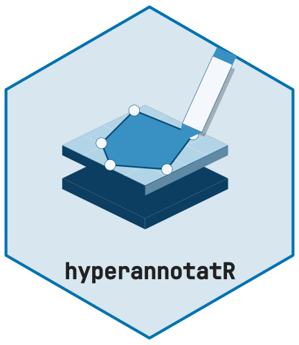

# The batch annotation app



Annotating one image is a job for
[`at_project()`](https://cttir.github.io/hyperannotatR/reference/at_project.md)
and the ROI constructors. Annotating a *queue* of images — repeated
acquisitions, a time series, a folder of hyperspectral cubes — is what
the annotation app is for. It wraps a Shiny app and a self-contained
HTML5 canvas around a resumable **session**, so you can work through
many images while retaining your place, labels and edits. Save a
checkpoint to preserve them after the app closes.
[`at_app()`](https://cttir.github.io/hyperannotatR/reference/at_app.md)
builds the app as an ordinary `shiny.appobj` from explicit arguments
(for embedding or testing), and
[`at_annotate()`](https://cttir.github.io/hyperannotatR/reference/at_annotate.md)
launches it.

## Building a session

A session is a queue of image paths plus a shared annotation template.
Build one explicitly with
[`at_session()`](https://cttir.github.io/hyperannotatR/reference/at_session.md),
or grab a ready-made one for experimentation with
[`at_example_session()`](https://cttir.github.io/hyperannotatR/reference/at_example_session.md),
which copies the bundled tissue image into a temporary directory so the
queue has real files to iterate.

``` r

sess <- at_example_session(3)
sess
#> <annot_session>
#> images: 3  |  complete: 0  |  cursor: 1
#> out_dir: /tmp/RtmpJplO5R/hyperannotatR-example-session-43c23746ffaa  |  autosave: TRUE
```

Every image starts with status `"pending"`, the cursor sits on the first
image, and per-image projects are materialised lazily — nothing is read
from disk until you visit it.

## Layer templates and label vocabularies

Two things are shared across the whole queue. The **label vocabulary**
is the flat list of allowed labels, bound to the number keys `1`–`9`.
The **layer template** is a list of
[`at_layer()`](https://cttir.github.io/hyperannotatR/reference/at_layer.md)
objects — with styles from
[`at_style()`](https://cttir.github.io/hyperannotatR/reference/at_style.md)
— stamped onto every image the first time you open it, so each slide
starts with the same empty layers ready to receive ROIs.

``` r

regions <- at_layer("regions", labels = c("tumour", "necrosis", "stroma"),
                    style = at_style(colour = "#E64B35", fill_alpha = 0.3))
lesions <- at_layer("lesions", labels = c("focus", "margin"),
                    style = at_style(colour = "#4DBBD5", z = 2))

paths <- at_session_status(sess)$path
templated <- at_session(paths,
                        labels = c("tumour", "necrosis", "stroma", "focus", "margin"),
                        layers = list(regions, lesions),
                        out_dir = tempdir())

at_layers(at_current(templated))
#> # A tibble: 2 × 6
#>   name    n_rois labels    visible locked     z
#>   <chr>    <int> <list>    <lgl>   <lgl>  <int>
#> 1 regions      0 <chr [3]> TRUE    FALSE      1
#> 2 lesions      0 <chr [2]> TRUE    FALSE      2
```

## Launching the app

With a session in hand, launch the application. This opens a browser and
blocks, so it is never run inside a vignette:

``` r

at_annotate(templated)
```

[`at_annotate()`](https://cttir.github.io/hyperannotatR/reference/at_annotate.md)
is forgiving about its first argument: pass a session, a project, an
image, a vector of paths, a directory, or `NULL` to open the bundled
example.

To embed the app, or to exercise it in tests without a browser, build
the app object instead. The session and read-only setting are explicit
arguments:

``` r

app <- at_app(session = templated, read_only = FALSE)
class(app)
#> [1] "shiny.appobj"
```

## Hyperspectral cubes in the app

For spectral cubes the **Display** panel switches the canvas between
natural colour, a single band, a pseudo-RGB / false-colour triple and
the registered band operations listed by
[`at_band_operations()`](https://cttir.github.io/hyperannotatR/reference/at_band_operations.md)
(ratio, normalised difference, band means). These are display products:
masks, spectra and exports always use the original cube values. The
**Cube** table shows the image kind, wavelength range and gaps, value
unit, calibration state, plane and how many bytes have been read. The
**probe** tool picks a pixel whose spectrum appears on the Summary page
next to ROI and layer spectra, and **Download region** exports the raw
values of a selected ROI, the current view or custom bounds as an ENVI
cube with provenance.

## Reference lengths and estimated spatial scale

A reference layer records repeated measurements of a visible dimension
in each image. Create it with `role = "calibration_reference"` and a
label for each dimension you intend to measure. An optional
`reference_assumptions_mm` list gives an initial assumed length in
millimetres for each label:

``` r

reference <- at_layer(
  "Reference", labels = "reference dimension",
  role = "calibration_reference",
  # Illustrative assumption only: replace with the length of your reference.
  reference_assumptions_mm = list("reference dimension" = 2)
)
reference_session <- at_session(
  paths, layers = list(regions, reference),
  out_dir = tempfile("reference-session-")
)
```

Select the reference layer and label on the Annotate page. The app
selects **Distance** automatically: click two distinct endpoints inside
the image to record one measurement. Repeat the same reference dimension
at least three times; five measurements are recommended. The panel then
shows the mean and sample standard deviation in level-0 pixels.
**Measurements (px)** lists the included lengths. Copied ROIs, area
shapes and invalid segments are excluded, so copying a measurement to
another image does not count as a new repeat. Undo and redo restore the
saved reference geometry.

The reference controls apply to the selected layer and label:

- **Global reference length (mm)** and **Apply globally** set the
  default for this session. Images with their own overrides keep them.
- **Image reference length (mm)** and **Apply to image** set an override
  for the current image.
- **Use global default** removes the current image’s override, so it
  follows the session default again.

Lengths must be finite and greater than zero. The panel identifies
whether the effective value comes from the global default or an image
override. Successful checkpoints preserve the reference endpoints,
session defaults and image overrides; with autosave disabled, save
before closing the app. Global defaults are also copied into
materialised projects when they are saved.

Once three valid measurements and an assumed length are available, the
displayed estimate is
`assumed length in mm / mean measured length in pixels`. This assumes
square pixels and the stated physical reference size. The app labels
that size **unverified**: drawing repeats does not establish that the
assumption is true. It does not assign a physical pixel size to the
image, change its stored coordinate units, or convert masks and exported
geometry to millimetres. This spatial estimate is separate from
dark/white calibration of spectral values.

## Staged changes and status

Annotations proposed by a partner package, such as a qupflowR handoff
imported on the Data page or a control command, arrive as a **staged**
patch. The Annotate page lists its creates, updates and conflicts;
reviewed or locked ROIs are never changed automatically. Commit or
discard it explicitly. One badge next to the save controls always shows
the state (*read-only*, *unsaved*, *staged*, *committed* or *saved*),
followed by a line with the time and folder of the last checkpoint, or a
warning when that folder is temporary. See
[`vignette("partner-interop")`](https://cttir.github.io/hyperannotatR/articles/partner-interop.md)
for the contract behind this.

## Keyboard shortcuts

The canvas is built for speed, so almost everything has a key. Pick a
layer and a label (radio buttons, or a digit for the label), draw, then
commit and advance; **Undo**, **Redo** and **Copy previous** are also
buttons next to the tools. Shortcuts are inactive while a text field,
list, button or link has focus (label and layer radios keep them), while
a dialog is open, and, except for `?`, away from the Annotate page. The
table below is the one the app shows when you press `?`:

| Key | Action |
|:---|:---|
| Arrows / Shift+arrows | canvas cursor: 1 / 10 image pixels |
| Enter / Space | point/rectangle anchors; polygon: Space vertices, Enter finish |
| Escape | cancel unfinished drawing/edit |
| n / p | next / previous image |
| N | next pending image |
| 1-9 | select label |
| q w e r t y | Pan / Rectangle / Polygon / Freehand / Round area / Point |
| d | delete last region |
| Ctrl+Z / Ctrl+Shift+Z | undo / redo |
| Shift+Enter | save, mark complete & advance |
| Shift+V | paste previous image’s ROIs |
| f | flag image |
| s | save session |
| Ctrl+E | open export |
| ? | shortcut help |

Drawing also works without a mouse. Tab to the canvas: the arrow keys
move a cursor by 1 level-0 image pixel (10 with Shift), Enter or Space
places a point and starts or finishes a rectangle, Space places polygon
vertices and Enter finishes the polygon after at least three, and Escape
cancels an unfinished drawing or edit. A new shape is drawn dashed until
the server accepts it. Drawing needs an active label and an unlocked
layer; otherwise the app warns and no shape is added.

The canvas shows a downsampled overview of the image (at most 2048
pixels on its longest side) with pan and zoom; it does not stream
pyramid tiles. Drawing coordinates are always level-0 image pixels.
Encoding the canvas image needs `magick`: TIFF reading can use `tiff`,
but PNG images, including the tissue example, need `magick`. A missing
capability or an image that fails to decode is reported before drawing
is enabled, and navigation keeps working when the current image fails.

Label colours, layer visibility, opacity, stroke width and z-order
control the display. Hidden layers are neither drawn nor hit-tested on
the canvas, but they still take part in masks and exports: visibility is
not an analytical filter. Locked layers and protected imported ROIs
cannot be edited or removed through the canvas, the keyboard, the ROI
table or undo/redo, and labels cannot be added to a locked layer. These
protections apply in the app; the R functions can still edit everything.

## Copy-forward for serial sections

Adjacent serial sections often share most of their anatomy. Rather than
redraw it, press `Shift`+`V` to copy the previous image’s ROIs into the
unlocked layers of the current one, then use the edit tool to move whole
regions into place. Combined with `Shift`+`Enter` (commit and advance),
a run of near-identical sections can be annotated in a few keystrokes
each.

## Autosave and recovery

With `autosave = TRUE` (the default), the app writes the session to
`_session.rds` in its `out_dir` after every annotation change. The badge
shows *saved* only after the checkpoint has been written. A failed save
leaves the current edits marked unsaved and keeps the previous valid
checkpoint; press `s` to retry. With `autosave = FALSE`, navigation
keeps edits in memory and the indicator stays unsaved until a save
succeeds. Resume the last successful checkpoint with
[`at_resume()`](https://cttir.github.io/hyperannotatR/reference/at_resume.md).

Each new session gets its own temporary output directory, which R
deletes when it exits, and the app warns about it; for real work pass a
persistent `out_dir` to
[`at_session()`](https://cttir.github.io/hyperannotatR/reference/at_session.md)
or
[`at_annotate()`](https://cttir.github.io/hyperannotatR/reference/at_annotate.md).
In scripts,
[`at_save_session()`](https://cttir.github.io/hyperannotatR/reference/at_save_session.md)
refuses to replace an existing checkpoint unless you pass
`overwrite = TRUE`, also when you omit `path`; app autosave asks for
replacement explicitly. Before the app first replaces an existing
`_session.rds` that holds another queue, or ROIs the new checkpoint
lacks, it keeps a timestamped `_session-*.previous.rds` copy.

All browser tabs of one app object share its in-memory queue, so
reloading the page or opening a second tab continues from the latest
edits; two tabs editing the same image keep the last edit. Loading
another folder on the Data page writes the new queue into its own
subfolder and keeps the previous queue, including its unsaved
annotations and history, so **Restore previous queue** can bring it
back. That recovery copy lives only in the running app: restore and save
it before closing. An app attached to a control service refuses folder
loads; the controller loads sessions instead.

### Folder restrictions

The Data page reads folder and handoff paths on the machine running R.
For local use, `options(hyperannotatR.app_root = "/allowed/folder")`
restricts these inputs to a chosen folder. Paths are compared after
resolving symbolic links. Folder discovery checks each directory before
walking it and each candidate image before loading it; links resolving
outside the allowed root are skipped. Known ENVI header/payload pairs
and TIVITA profile sidecars are checked too. In-root links remain
usable, and linked directory cycles are visited only once. A message
explains skipped links; if no allowed image remains, the existing queue
and its unsaved edits are retained.

Staged imports check handoff inventories and mask legend sidecars before
reading them. Handoffs prohibit descendant symbolic links, including
in-root links; the app refuses these before recursively listing the
handoff. A refused import leaves existing annotations unchanged, and a
valid handoff can still be staged afterwards.

This option governs Data-page inputs, not an operating-system sandbox or
every path accepted by the R API. It does not contain custom reader
code, qualify additional file references opened internally by external
readers, or prevent another process from replacing files between a path
check and a read. Keep the app local and use operating-system
permissions and trusted readers when access must be restricted. A shared
deployment needs its own access controls.

``` r

sess <- at_set_status(sess, 1, "complete")
sess <- at_next(sess)

at_save_session(sess)
recovered <- at_resume(file.path(sess$out_dir, "_session.rds"))
recovered
#> <annot_session>
#> images: 3  |  complete: 1  |  cursor: 2
#> out_dir: /tmp/RtmpJplO5R/hyperannotatR-example-session-43c23746ffaa  |  autosave: TRUE
```

The cursor, statuses, materialised projects, and templates all come back
intact.

File-backed images are saved as a versioned source descriptor (the
canonical source path, backend and reader options), not as pixels, and
are reopened when needed; keep the original source files available.
In-memory images keep their only pixel copy. A session whose sources are
unavailable still loads, with its annotations intact.

``` r

at_inspect_saved("annotations/_session.rds")
project <- at_current(recovered)
at_inspect_source(project)
project <- at_relink_source(project, "/new/location/original.tif")
recovered$projects[[recovered$cursor]] <- project
at_save_session(recovered, overwrite = TRUE)
```

Relinking explicitly accepts a replacement source after checking its
size, pyramid levels, bands and wavelengths. For readers with
non-default options, pass `options = list(...)` when an old file does
not record them. The saved source signature compares file size and
modification time: it detects many replacements but cannot prove
identical content. ENVI provenance includes both header and payload;
TIVITA SpecCube provenance includes the selected profile sidecar when
used. Discovery is checked as well, so a newly preferred companion or a
redirected link cannot silently replace the recorded decoding input.
These companion checks also run before a cached ENVI or TIVITA tile is
reused.

Missing or changed inputs, and legacy sources whose decoding metadata
cannot be verified, leave the annotations available but prevent pixel
reads. Use
[`at_inspect_source()`](https://cttir.github.io/hyperannotatR/reference/at_inspect_source.md)
to investigate, restore the original files where appropriate, or
explicitly revalidate with
[`at_relink_source()`](https://cttir.github.io/hyperannotatR/reference/at_relink_source.md).
Do not accept a replacement solely to clear the error: its identity and
scientific suitability still need checking.

Queue entries saved without identifiers are migrated by their recorded
row position; existing valid identifiers and geometry are kept. Older
lightweight images reopen through the known default readers, and
inspection reports that their reader options were inferred. Ambiguous
identities and unsupported schemas are refused;
[`at_inspect_saved()`](https://cttir.github.io/hyperannotatR/reference/at_inspect_saved.md)
reports such issues without modifying the file.

App checkpoints write complete, uniquely named project files before
replacing the session file, and keep the project files that older
checkpoints refer to. On Unix the replacement is a checked rename in the
same directory; on Windows the previous file is backed up and restored
if an ordinary write fails. Neither guarantees durability across a power
loss. Do not delete retained project files while a checkpoint still
refers to them.

## The session API without the app

Everything the canvas does to a session is available as plain functions,
which is what makes batches scriptable and testable. Inspect the queue
with
[`at_session_status()`](https://cttir.github.io/hyperannotatR/reference/at_session_status.md),
walk it with
[`at_next()`](https://cttir.github.io/hyperannotatR/reference/at_next.md)
/
[`at_prev()`](https://cttir.github.io/hyperannotatR/reference/at_prev.md)
/
[`at_goto()`](https://cttir.github.io/hyperannotatR/reference/at_goto.md),
and read a richer progress report — one column per label — with
[`at_manifest()`](https://cttir.github.io/hyperannotatR/reference/at_manifest.md).

``` r

at_session_status(sess)
#> # A tibble: 3 × 9
#>     idx entry_id              export_stem path  name  status project_path n_rois
#>   <int> <chr>                 <chr>       <chr> <chr> <chr>  <chr>         <int>
#> 1     1 entry_at_43c2b7f16fa… entry_at_4… /tmp… imag… compl… NA                0
#> 2     2 entry_at_43c2b7f16fa… entry_at_4… /tmp… imag… pendi… NA                0
#> 3     3 entry_at_43c2b7f16fa… entry_at_4… /tmp… imag… pendi… NA                0
#> # ℹ 1 more variable: modified <dttm>

at_manifest(sess)
#> # A tibble: 3 × 11
#>     idx entry_id  export_stem name  path  status n_layers n_rois tumour necrosis
#>   <int> <chr>     <chr>       <chr> <chr> <chr>     <int>  <int>  <int>    <int>
#> 1     1 entry_at… entry_at_4… imag… /tmp… compl…        0      0      0        0
#> 2     2 entry_at… entry_at_4… imag… /tmp… pendi…        0      0      0        0
#> 3     3 entry_at… entry_at_4… imag… /tmp… pendi…        0      0      0        0
#> # ℹ 1 more variable: stroma <int>
```

Use these to seed a session programmatically, pre-fill statuses, or
audit progress in a report — no Shiny required.

## Export scoping

The export panel (`Ctrl`+`E`) writes the selected **formats** (an
integer TIFF mask with its legend sidecar, GeoJSON, QuPath GeoJSON, and
an ROI table as CSV) for a **scope**: the current image, every image
marked complete, every flagged image, or the whole queue. The current
image is exported from the live project, other entries from the
session’s stored projects, and every layer is included; the app has no
layer selector. Scope `all` includes flagged and skipped images, so
choose `complete` when only reviewed annotations should leave the
session. The zip download holds every complete bundle plus the receipt,
and a copy is written to the session’s export folder. The receipt lists
complete files, skips and errors; check it before assuming that every
requested image and format succeeded. To export a subset of layers, call
the writers from R instead:
[`at_write_geojson()`](https://cttir.github.io/hyperannotatR/reference/at_write_geojson.md),
[`at_write_qupath()`](https://cttir.github.io/hyperannotatR/reference/at_write_qupath.md)
and
[`at_mask()`](https://cttir.github.io/hyperannotatR/reference/at_mask.md)
take a `layer` argument.

Those export formats — and how hyperannotatR round-trips with QuPath,
GeoJSON, and mask TIFFs — are the subject of the next vignette,
“Interoperability”.
