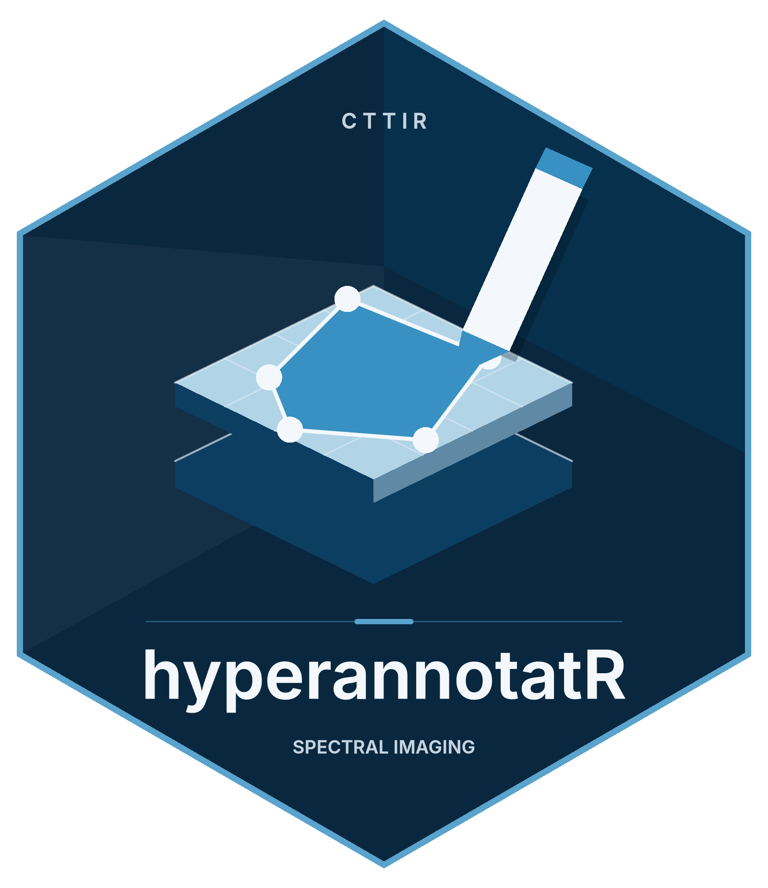

```{r hexlogo, echo=FALSE, fig.align="right", out.width="110px", fig.alt="hyperannotatR logo"}

```

```{r setup, include=FALSE}
# The example project is a PNG (read with magick); masks are written as TIFF.
has_raster <- requireNamespace("magick", quietly = TRUE) &&
  requireNamespace("tiff", quietly = TRUE)
knitr::opts_chunk$set(collapse = TRUE, comment = "#>", eval = has_raster)
library(hyperannotatR)
```

hyperannotatR and the qupflowR package (a QuPath bridge, analysis and workflow
package) exchange annotations, masks, hyperspectral metadata and deep-learning
datasets through a small, versioned contract. qupflowR never reaches into
hyperannotatR internals, Shiny state, `inst/` files or the browser DOM; it uses the
public functions below, the files they write, or the optional local control
service. This vignette describes that contract from the hyperannotatR side.

## What this installation supports

```{r capabilities}
caps <- at_interop_capabilities()
caps
caps$profiles$I2[c("status", "implemented", "available", "reason")]
```

The profiles are:

| Profile | What it covers | Status rule |
|---|---|---|
| I0 | file interchange: handoff directories, QuPath GeoJSON, masks with legends | supported |
| I1 | public R API (`at_*` functions) | supported |
| I2 | loopback control service `annotatr-control-v1` | `planned` until qualified with a real qupflowR client; `unavailable` without httpuv/later |
| I3 | embeddable app object from `at_app()` | `planned` until qualified; `unavailable` without shiny/bslib/shinyjs/htmlwidgets |

A capability is never advertised as supported because it merely exists. The
report carries a `digest` (SHA-256 of its canonical JSON) that manifests and
handshakes repeat, so a partner can bind its expectations to exactly this set.

## Handoff directories

`at_export_qupflowr()` writes a new, self-contained directory of neutral files:

```{r export}
proj <- at_example_project()
dest <- file.path(tempdir(), "qupflowr-handoff")
receipt <- at_export_qupflowr(proj, dest, formats = c("qupath_geojson", "mask_tiff", "manifest"),
                              overwrite = TRUE)
receipt$files[, c("path", "size_bytes", "format")]
receipt$handoff_digest
```

- `annotations_qupath.geojson` uses the QuPath 0.4+ dialect with a stable UUID
  per ROI and hyperannotatR's ROI id, layer, source and coordinate level in
  `properties.metadata`.
- `masks/<layer>_labelled.tif` holds one integer value per ROI; its
  `.legend.json` joins values to ROI ids, labels and colours.
- `image.json` and `manifest.json` identify images by content hash and file
  basename only. No absolute path is used as identity.
- `integrity.json` inventories every other file (`path`, `size_bytes`,
  `sha256`, sorted by path). The **handoff digest** is the SHA-256 of its
  canonical JSON (keys sorted, no whitespace, integer sizes, no trailing
  newline) — the same rule qupflowR uses for its bundle digest.

Files are written to a hidden staging directory and moved into place only when
complete. An existing destination is replaced only with `overwrite = TRUE`, and
only if it is itself a handoff directory.

A session export writes each queue entry under `entries/<entry_id>/`. Entry ids
come from the session manifest's stable `entry_id` (falling back to
`entry-0001`, ... for older sessions), and the manifest's ROI, layer and file
records carry the `entry_id` they belong to, so two entries showing the same
image stay separate. Project masks have the ids `project:<layer>`.

### The manifest

```{r manifest}
man <- receipt$manifest
man[c("schema", "schema_version", "consumer", "object_kind")]
str(man$coordinate_convention)
man$images[[1]][c("image_id", "source_name", "width", "height", "n_bands", "transform_digest")]
man$annotations$annotation_revision
```

The coordinate convention is explicit: pixel units, origin at the top-left
corner, `y` increasing downward, planes indexed from zero, and the pixel
coverage rule for masks. QuPath object hierarchy and native ROI shapes, which
hyperannotatR does not model, are reported as `"unknown"` or `"approximated"`
(circles and ellipses are polygons) instead of being invented.

## Importing, staging and committing

`at_import_qupflowr()` reads only the neutral contract. It verifies the
inventory (missing, extra, duplicate, resized, altered and symlinked files), the
manifest schema and its major version, the id join between manifest and
GeoJSON, labels, mask dimensions, integer values and legend completeness. Any
failure is a classified error with a machine-readable `code` (for example
`DUPLICATE_ID`, `LEGEND_INCOMPLETE`, `MASK_INVALID`, `FORMAT_UNRECOGNISED` or
`INVALID_JSON`, which also covers duplicate JSON keys); nothing is written and
no analysis runs. Operating-system metadata files that are not in the inventory
(`.DS_Store`, `._*`, `Thumbs.db`, `desktop.ini`) are ignored with a warning.
The conversion table's `geometry_match` reports `"exact"` when the geometry is
byte-identical to its manifest record, `"equivalent"` when an export at another
pyramid level agrees with it within a relative `1e-9` after rescaling, and
`"changed"` otherwise.

```{r import}
report <- at_import_qupflowr(dest, expected_revision = at_annotation_revision(proj))
report$checks
```

Changes are applied in two explicit steps. Staging joins ROIs by id and
classifies each change. Reviewed or locked ROIs and locked layers, including a
locked target layer of a new or moved ROI, are never changed automatically but
reported as conflicts. ROIs whose ids were minted on import, because the file
carried none, are always staged as new ROIs:

```{r stage}
partner <- report$objects$layers$regions
partner <- at_layer_add(partner, at_roi_rect(10, 10, 60, 60, label = "stroma", id = "from-partner"))
patch <- at_stage_qupflowr(proj, partner, expected_revision = at_annotation_revision(proj))
patch$operations
```

Committing is idempotent: the same key replays the original receipt, a reused
key for a different patch is refused. When the patch targets a project file,
the file's revision is checked again immediately before it is replaced, and
replacing an existing file requires `overwrite = TRUE`.

```{r commit}
receipt <- at_commit_qupflowr(patch, idempotency_key = "vignette-commit")
receipt$new_revision
at_commit_qupflowr(patch, idempotency_key = "vignette-commit")$replayed
```

## Hyperspectral metadata

Spectral images keep the format-independent tile contract `[y, x, band]`.
Metadata travels with them explicitly:

```{r hsi, eval = TRUE}
cube <- at_example_image("cube")
head(at_bands(cube), 3)
at_hsi_meta(cube)[c("image_kind", "value_unit", "interleave", "byte_order", "header_bytes",
                    "calibration_digest", "window_read")]
```

Raw values, reflectance, radiance, intensity and absorbance are never mixed:
`at_convert_values()` implements the named conversions and refuses to guess a
missing calibration. ENVI and TIVITA cubes are read window by window, so
opening, printing or displaying a cube does not load it; `at_read_stats()`
reports the bytes read. A TIVITA `*_SpecCube.dat` is decoded only through a
declared `at_tivita_profile()` or a `<cube>.tivita.json` sidecar. Cubert
`.cu3s` files need `cuvis.r` and the CUVIS SDK; without them the backend reports
itself unavailable and an SDK-written ENVI export is the portable fallback.
Display products from `at_band_view()` (ratios, normalised differences, band
means) carry their parent digest and band list and are never used as analysis
input.

## Deep-learning training datasets

```{r training}
sess <- at_example_session(3)
for (i in seq_len(3)) sess$projects[[i]] <- at_example_project()
ds <- at_training_export(sess, file.path(tempdir(), "training-dataset"), tile_size = 128,
                         mask_type = "labelled", seed = 11, overwrite = TRUE)
ds$manifest$split_policy$algorithm
ds$manifest$counts[c("tiles", "tiles_by_split", "excluded")]
ds$checks
```

Splits are assigned per group, so tiles of one group never occur in two
splits. The default group is the image, identified by its content hash
(including any non-default series, plane or measurement). The three example
entries are copies of one picture, so they form a single image group and all
land in one split: tiles of one image never leak across splits. Distinct images
spread over the splits. Group by `sample_id` or `subject_id`, supplied in
`groups`, when several images come from one sample or one patient; entries
that show the same pixels must still share a split, and `at_training_check()`
reports an image found in two splits as leakage. The manifest records tile size, overlap, level, pixel origin, coverage
rule, class legend (background `0`), band list with wavelengths and FWHM,
value unit, calibration and transform digests, annotation revisions and review
status counts. `at_training_check()` re-verifies the inventory, split leakage,
mask dimensions, label range and a mask-to-ROI round trip.

Model predictions come back as staged annotations. They must match the image
dimensions and use only codes from the label map; reviewed annotations are
never overwritten:

```{r predictions}
pred <- matrix(0L, 512, 512)
pred[20:80, 30:120] <- 1L
staged <- at_training_import(proj, pred, label_map = c(tumour = 1L),
                             model = list(name = "example-unet", version = "0.1",
                                          sha256 = strrep("0", 64)))
staged$summary
```

Training itself remains an external, optional workflow.

## The control service

A partner process can drive a running app through the loopback service. It is
off unless started, binds only to `127.0.0.1`, authenticates with a random
bearer token that expires, rejects browser-origin requests and oversized
bodies, resolves file references only below its root, and offers no endpoint
that evaluates R, shell or Python code. Tokens come from the operating system's
random source (`/dev/urandom`) or, where that does not exist (Windows), from the
optional `openssl` package; without either, the service refuses to start.

```{r control, eval = has_raster && requireNamespace("httpuv", quietly = TRUE)}
handle <- at_control_start(at_example_session(2), serve = FALSE)
state <- at_control_state(handle)
state$state_revision
at_control_command(handle, list(operation = "context.goto", payload = list(queue_index = 2),
                                expected_revision = state$state_revision))$entry_id
vapply(at_control_events(handle)$events, `[[`, character(1), "type")
at_control_stop(handle)
```

In a real integration the app runs in its own process:

```{r control-process, eval = FALSE}
handle <- at_control_start(session, token_file = "/run/user/1000/annotatr.token")
shiny::runApp(at_app(control = handle))
# ... in the partner process:
remote <- at_control_connect(manifest_path, "/run/user/1000/annotatr.token")
```

Every mutation carries a `request_id`, the `expected_revision` it is based on,
an `idempotency_key` and the SHA-256 of its canonical payload. A stale revision
is a conflict; a lost response is resolved with
`at_control_request_status()`, and re-sending with the same key never applies
a command twice. Events are read with a cursor; a cursor from another instance
or older than the retained buffer yields `resync_required = TRUE`.

A few further rules matter to clients:

- `session.load` refuses with `UNSAVED_CHANGES` (409) while the current session
  has unsaved or staged edits, unless the payload sets `discard_unsaved: true`.
  A loaded session gets its own output directory under `<root>/sessions/`,
  reported as the relative `session_dir`.
- Re-sending an idempotency key whose record has already been evicted returns
  `IDEMPOTENCY_EXPIRED` (409) instead of running the command again.
- `mask.preview` refuses masks larger than
  `options(hyperannotatR.control_mask_max_pixels)` (default 4096^2 pixels) with
  `MASK_TOO_LARGE` (413).
- `GET /v1/state` reports `image_id: null` for unvisited queue entries larger
  than `options(hyperannotatR.control_hash_max_bytes)` (default 256 MiB) rather than
  hashing them while the app waits.
- `close` is not revision-checked. Once the token has expired, the listener
  shuts down.
- Error bodies carry the condition `class` alongside the `code`. Paths in errors
  are reported relative to the root, never as absolute paths.
- The remote client ignores `http_proxy`/`https_proxy` and never follows
  redirects, so the token only ever goes to the loopback address.
- On Windows the operating system does not enforce the token file's owner-only
  permission; keep it in a directory only you can read.

The JSON Schemas for all documents ship with the package:

```{r schemas, eval = TRUE}
basename(list.files(system.file("schema", package = "hyperannotatR"), recursive = TRUE))
```

## Versions and migration

Schema versions are independent of the package version. Readers accept any
`1.x` version, reject an unknown major version and keep unknown optional data
only under `extensions`. hyperannotatR 0.2.0 introduced `annotatr-handoff-v1`,
`annotatr-control-v1`, `annotatr-training-v1` and `annotatr-hsi-v1`; they are
now at version `1.1`. The `integrity.json` format stays at `1.0`, because its
digest rule is shared with qupflowR. Existing 0.1 files remain readable: legacy
QuPath GeoJSON (`object_type`, `colorRGB`) is imported, and
`at_write_qupath(dialect = "legacy")` still writes it.
